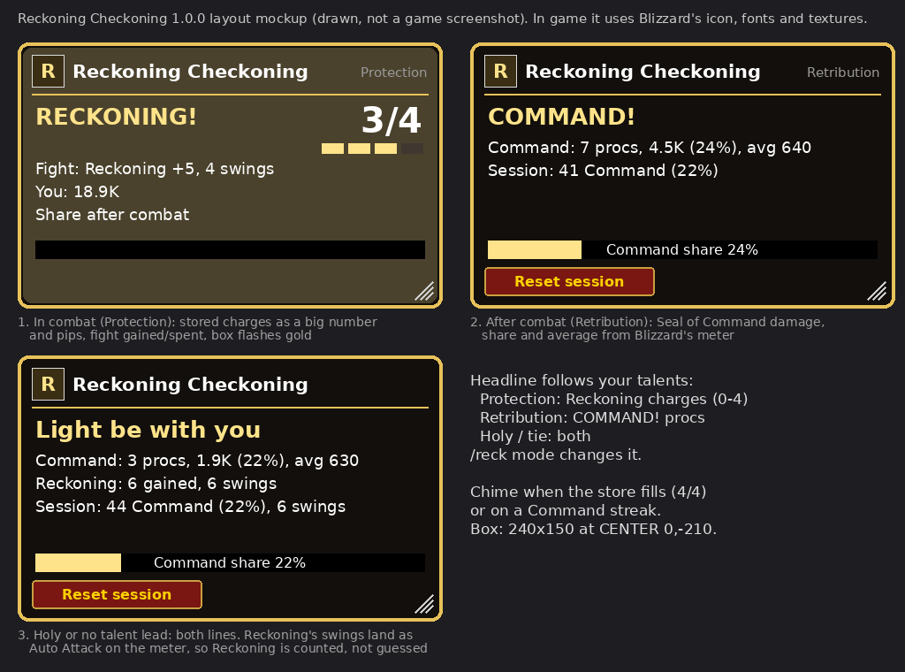

# Reckoning Checkoning (WoW: Forever) v1.0.0

  

A Reckoning and Seal of Command counter for Paladins. A small holy-gold box shows your stored **Reckoning** charges (0 to 4) and flashes **COMMAND!** every time Seal of Command procs. When the fight ends it shows Seal of Command's damage, its share of your damage and the average per proc, taken from the game's own damage meter.

## What it shows
- **Reckoning (Protection):** your stored charges as a big `3/4` with four pips, plus charges gained and extra attacks spent this fight. The box flashes gold when a charge lands and when the stored swings go off.
- **Seal of Command (Retribution):** `COMMAND!` and a proc count, live.
- **After combat:** Seal of Command damage, share and average per proc. If the game's meter ever lists Reckoning on its own line, its damage, share and average per extra attack too.
- **This session:** Command procs and share, and Reckoning swings. The **Reset session** button starts a new session (it hides during combat).

The box leads with whatever your talents point at: Protection shows Reckoning, Retribution shows Command, and Holy (or an even split) shows both. `/reck mode reckoning|command|both|auto` changes it.

## Where the numbers come from
WoW: Forever runs on the modern client, which gives addons **no combat log**, and every single hit's damage reaches addons as a hidden ("secret") value. Reckoning Checkoning never guesses a number:
- **Seal of Command procs** are exact: each proc is its own game spell (20424), and the game tells addons when you cast it.
- **Reckoning charges** come from the Reckoning buff's stack count (spell 1326084, up to 4). If the game hides that count during combat, the big number still shows it exactly as the game hands it over, and gains are counted from the buff being applied.
- **Damage** comes from **Blizzard's built-in damage meter**, worked out once combat ends.
- Reckoning's extra swings land on the meter as ordinary **Auto Attack**, so there is usually no Reckoning damage line. The box then says **"counting procs only"** and shows counts without damage. `/reck meter` lists the meter's lines for your last fight.
- No live per-hit numbers and no "biggest hit": the game does not give single hits to addons.

Turn on the game's meter if the box shows no damage: **Options > Gameplay > Advanced > Damage Meter > Enable Damage Meter**.

## Chime
`/reck sound big` (default): a chime when your Reckoning store fills (4 of 4) or when Seal of Command procs **2 times within 4 seconds**.
`/reck sound every`: every Command proc. `/reck sound record`: when a fight beats your best Command average. `/reck sound off`.
`/reck soundfile theme|chime|bell|holy` picks the sound and plays it once. All sounds are built into the game.

## Commands
Main command `/reck`; `/checkoning` works too.
`/reck show` / `hide` · `lock` / `unlock` · `resetpos` · `scale 0.5-2` · `size <width> <height>` · `reset` (session) · `test` (preview out of combat) · `mode …` · `sound …` · `soundfile …` · `theme` (re-check your talents) · `meter` · `debug` · `report`

The box only appears on a Paladin. Move it by dragging; resize it with the corner grip. Both stop working while it is locked.

## Install
1. Download the zip, or clone this repo into a folder named `ReckoningCheckoning`.
2. Put the `ReckoningCheckoning` folder in `World of Warcraft\_forever_\Interface\AddOns\` (the folder next to `_retail_`; the exact name may differ).
3. Restart the game or type `/reload`, and check Reckoning Checkoning is ticked in the AddOns list.

## In-game test checklist
1. On a Paladin, the box appears below the middle of the screen, can be dragged and resized, and keeps its place after `/reload`. `/reck lock` stops both. On other classes it stays hidden.
2. Protection with Reckoning: block or take a critical hit; the big number and pips go up (up to 4/4, with one chime when full). The next swing spends them and the swing count goes up.
3. Retribution with Seal of Command: `COMMAND!` flashes on each proc and the count goes up; two quick procs play one chime.
4. After the fight: Command damage, share and average appear, or "counting procs only". `/reck meter` lists the meter lines.
5. **Reset session** sets the session line back to 0 and is hidden in combat.
6. No Lua errors and no "action blocked" messages during combat.

## Licence
MIT. Written from scratch; no code copied from other addons.
